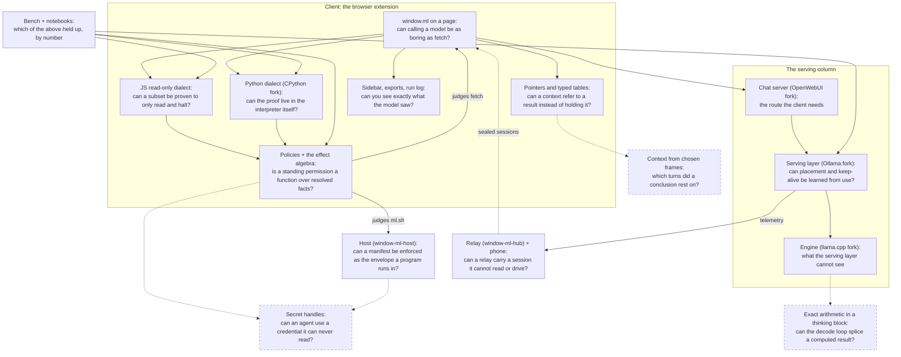

# window.ml

I'm an applied mathematician. This repo holds experiments on LLM inference: whether a server can learn where to
load a model and for how long from recorded use, whether it can predict decode speed and correct itself, and what
becomes possible once every piece of a context has an address. Agents write and maintain the code and I don't read
it. What I'm after is the findings. Some of it replaced chat UIs I was fed up with, and I use those parts daily.

The loose theme: what would it take for calling a model to be as boring as calling `fetch`? You call it and stop thinking
about it. It fails in known ways, takes about as long as you expected, and when something does go wrong you can see
exactly what happened.

An idea gets tried in the cheapest place first, usually an agent with a prompt and a tool. If it still looks good it
goes further down: into the serving layer, the inference engine, and for a few, eventually training. Some only work
if several of those change together, which is why the [apparatus](#apparatus) spans all of them.

So this is a hypothesis-testing apparatus more than a codebase. Every row of the table below is a claim that might
be wrong rather than a feature that is planned. What should outlast any of them is the finding: a short technical
note on how the thing works and whether it held up, and a proper implementation wherever it actually belongs. That
is what the third column is saying. None of those places is this repository.

## The ideas, and how far each got

So far this is mostly glue. Few of the ideas have actually been tested; the middle column says which.

I looked for existing tools that do these things before starting and did not find any. A few rows have relatives
that work on the same problem by a different mechanism; those rows say what the relative is and how this differs.

| Idea | Tried so far | Where it would end up if it works |
| --- | --- | --- |
| You can see exactly what the model saw on every run, and where the time went | the sidebar, the exports, the serving layer's event stream | everywhere |
| A tool's output is referred to by a short pointer instead of being copied back into the context. The closest relative is [code execution with MCP](https://www.anthropic.com/engineering/code-execution-with-mcp) (Cloudflare calls it Code Mode), where intermediate results stay in an execution environment unless the script returns them. Here the pointer is how the context itself refers to a tool's output, not something that exists only inside a script, and the end goal is a model trained to use it | a prompt and a dereference tool; one A/B pilot | post-training |
| The agent manages its own context: it collapses stale tool outputs to their pointers with a projection it picks, and expands them when it needs them again. Pointers name typed objects (a table, not its text) that JavaScript and Python compute over | typed table pointers both runtimes read; collapse itself not started ([notes](docs/spec/AGENT_COMPACTION.md)) | the agent, then post-training |
| Once every frame has an address, a context can be built from a chosen set of frames rather than only accumulated, which allows asking a fresh window what it makes of a conclusion without the turns that produced it ([below](#building-a-context-from-chosen-frames)) | not started | the agent |
| Arithmetic in a thinking block is worked out exactly and the result spliced into the output | not started | the engine's decode loop, then post-training |
| Where a model is loaded and how long it stays loaded is decided by the serving layer, learned from how models actually get used, with no knobs for the caller | in the serving layer; the routing a mixture of experts actually does is recorded in the engine | the serving layer |
| The client tells the serving layer who is waiting on each request and which requests belong together | sent and recorded, as data for the placement and keep-alive predictor | the serving layer |
| Each generation's decode speed is predicted and the prediction corrected from what is measured | in the serving layer; a median error of 1.4% over 8,613 generations (`notebooks/bench/serving-decode.ipynb`) | the serving layer |
| Read-only work runs without asking me; everything else asks. The permission is whether the script is written in a dialect of the language that can only read, always halts, and leaves nothing behind when it refuses. Where the proof lives depends on the runtime: in JavaScript it is an interpreter beside V8, which cannot be touched; in Python it goes into the interpreter itself, as a restricted mode of CPython whose gates sit in the object layer, with the build's specialization switch part of the argument | [the JavaScript dialect](docs/dev/readonly-exec.md), in daily use; the Python one as a CPython fork that runs natively and under Pyodide, whose first slice costs about 6% on 684 real cells and 1.66x on pure-Python benchmarks, measured, and which bounds each cell's memory on both platforms with a cap that fails closed: about 4% at the upper quartile over 1,702 real cells, 1.36x only on a bare loop of approved C calls; the fork's Pyodide build is pinned as a release of the fork, with the fail-closed release in review. In the extension, `python_exec`'s `mode` is gone: a cell reaches `ml` over the same wire as JavaScript, matplotlib figures come back as images, and a cell inside the dialect runs unasked under the fork's gate while every other cell asks ([notes](docs/spec/PYTHON_DIALECT.md)) | the agent; for Python, the language runtime |
| A standing permission is a function over a call's resolved facts, written in that same dialect so that it halts and can only answer. My rules and the built-in free tier are the same kind of object, listed on one page, and nothing widens a grant from a button on a card | the policy realm of the dialect, a store with global and run scopes, a policy page, and three consumers: remembered URLs, `ml.sh` calls, and a tool by which the model proposes a run policy that only the person's answer on a card adds; a call that asks says why when the policy that covered it is gone. A lifter turns a policy that fits a typed fragment into a tree, and covers 63% of the policies models write for `fetch` and 45% for `sh` (15 models), below what was predicted; not built: the tree as what a card leads with, and folding the older grant stores into the one page ([notes](docs/spec/POLICIES.md)) | the agent |
| What a call can affect is one algebra of (operation, resource) pairs. A library, a program and a fetch describe themselves in it, and "runs without asking" is a subset test against what the sandbox at that placement bounds | the algebra as code; manifests for nine programs, with a root's top-level names outside the free tier and `write-names` a manifest word; under the host's sandbox the judged claims are sent as the envelope; the same corpus deciding which Python the dialect admits ([notes](docs/spec/EFFECTS.md)) | the agent, and the manifests that ship with tools |
| Processes are a capability of the one executor, reached as `ml.sh` under the same rules, never a second world the model has to carry data between. The host is a separate program the browser attaches to, built with no relay code in it, and under its sandbox a manifest's description of a program is enforced as the envelope the program runs in, so a wrong manifest fails the command rather than granting an effect | [the host](https://github.com/parawanderer/window-ml-host), v0.5.0, is reachable as `ml.sh` from JavaScript and from a full Python cell; a call a policy covers runs, a call whose effects stay inside what the sandbox bounds plus reads in its roots runs by default, and anything else asks on the running step, with a card showing the program's facts, never the script. Each call starts under the envelope its judged facts derive, enforced by bubblewrap and Landlock on Linux and by Seatbelt on macOS, with the root's top-level names and `.git` hooks and config held read-only from one list; every call reports what changed among those names, and the result says which envelope the host applied. The hub transport is built behind an optional feature the default build does not compile, and no client drives it yet ([notes](docs/spec/SHELL.md)) | the host, on the person's machine |
| An agent uses my credentials without ever being able to read them: it holds a handle, and the secret stays in the client's background worker. Holding a handle while a broker keeps the secret is an old pattern in security; I have not found it done for a browser agent | not started; its place among policies, the effect algebra and processes is now written down ([notes](docs/spec/SECRET_HANDLES.md)) | the client's background worker, and the host for the secrets processes need |
| I drive an agent at home from my phone through a relay designed so that it cannot drive the agent itself | [the relay](https://github.com/parawanderer/window-ml-hub) carries sealed traffic and a connector republishes a box's telemetry through it, self-hosted. The client's own connector is not built, so nothing drives an agent through it yet ([notes](docs/spec/RUNTIME_HUB.md)) | a small relay server, and the client |

<!-- TODO: one flat sentence in the placement row on what the stock scheduler could not do without the caller tuning it. -->

### Building a context from chosen frames

What the pointer mechanism then makes possible is itself the interesting part. Once every frame has an address, a
context is something you build from a chosen set rather than only accumulate: from a run of turns 1..N, assemble a
window holding only 1..N-K and ask it what it makes of the conclusion the dropped turns produced. It is seeded with
the original frames rather than a summary of them, so unlike a subagent it can read that conclusion without having
been told what to think of it, and sweeping K measures which turns the conclusion actually rested on.

Not started. Dropping a suffix is the sound case, since everything dropped is downstream of everything kept;
masking an interior block is not, because the conclusions it produced stay behind.

The closest relative is [ContextCite](https://github.com/MadryLab/context-cite) (Cohen-Wang et al., NeurIPS 2024),
which includes and excludes parts of a context and fits a surrogate model to score which parts a response depended
on. That attributes a single response to sources in a single prompt. This is a different object: an agent
reassembling its own history from the original frames, and a fresh window judging a conclusion rather than a score
being fitted. What it shares is the cost. One sample from a stochastic model says little, so each K needs several
runs; for scale, ContextCite reports its results from 32 ablations per attribution.

**Right now.** Finishing the first row, because the rest depends on it: the benchmark tooling reads that data and
the pointer A/B needs the benchmark, so both are paused until it is done. In the serving layer I am working on
predicting placement and keep-alive from recorded use, which is a statistics problem rather than a coding one.

## Apparatus

The experiments need a client that produces real tasks, a chat server, a serving layer and an inference engine.
Each is an existing tool, modified where an idea required it, because starting from them was cheaper than generating
the equivalent from scratch. None of them is the point, and any could be swapped for something that does the same
job.

- **Client:** a browser extension that puts `window.ml` on web pages (this repository). A web page is an easy
  source of real tasks with me watching.
- **Chat server:** [a modified OpenWebUI](https://github.com/parawanderer/open-webui), where the client needs a
  route it does not have.
- **Serving layer:** [a heavily modified Ollama](https://github.com/parawanderer/ollama). The changes are in the
  scheduler: what it reports about itself, and what it learns to predict from use.
- **Engine:** [a modified llama.cpp](https://github.com/parawanderer/llama.cpp), for what the serving layer cannot
  see or change.
- **Relay:** [window-ml-hub](https://github.com/parawanderer/window-ml-hub), written for this, which lets devices
  reach each other's runtimes.
- **Host:** [window-ml-host](https://github.com/parawanderer/window-ml-host), written for this, which runs processes
  for the client on the machine it is attached to, under the operating system's sandbox. It is not the relay and the
  relay is not it: either works without the other.

The modified tools are not kept in step with their upstreams, and nothing is written up in them: notes and findings
land here, in `docs/`.

The pieces, what each one is asking, and what is measured there (open to see the map)

Every node is a question. An edge is how one piece reaches another. The line under each node is what has been
measured or tested there so far; a piece with neither would not be on the map.

- **window.ml**: the API, site access and the origin gate; `tests/redteam.test.js` and the site-access e2e are what a hostile page must not get.
- **JS dialect**: in daily use; the whitelist, halting and the inert reference are the adversarial tests under `test:core` and `test:security`.
- **Python dialect**: the fork's first slice costs about 6% on 684 real cells; the memory cap about 4% at the upper quartile on 1,702 real cells, 1.36x only on a bare loop of approved C calls (`notebooks/python-dialect/verify-cost/`, landing with the re-pin); `test:python` runs real CPython; the fork's own `test_restricted` runs on the fork.
- **Pointers**: one pilot of the identifier's form (2026-09-03, one model, 8 runs): the model retyped the data instead of dereferencing it in every run of both arms, so the form made no difference and the full sweep is not run; typed table pointers both runtimes read; collapse not started.
- **Policies + effects**: the lifter covers 63% of model-written fetch policies and 45% of sh ones (15 models); the effect algebra's subset test and nine program manifests; `test:security` holds the chokepoints.
- **Sidebar and exports**: the run log carries what the model saw; `test:panel` and `test:ext` draw it, the e2e demos narrate it.
- **Host**: v0.5.0; every call reports what changed among a root's protected names; ownership of every spawned process up to three named residuals; the memory bound is next.
- **Relay + phone**: sealed traffic and a box's telemetry republished; nothing drives an agent through it yet; `test:mobile` and `test:chat` cover the phone app and the chat page.
- **Serving column**: decode speed predicted per generation with a median error of 1.4% over 8,613 recorded generations on 13 models (75% within 10%, the 90th percentile 43%; `notebooks/bench/serving-decode.ipynb`); the correction is what does it, the 165 uncorrected predictions run 74% too fast; placement and keep-alive prediction not measured yet; the engine's routing record of a mixture of experts not measured yet.
- **Dashed nodes**: posed, nothing measured. Chosen frames and secret handles have a spec each (`AGENT_COMPACTION.md`, `SECRET_HANDLES.md`); exact arithmetic has none yet.
- **Bench + notebooks**: 2,635 scored runs over 21 models, 23 tasks and 26 sweeps in 13 days; $6.72 of cloud spend on the calls that recorded a price, a lower bound (`notebooks/bench/spend-to-date.ipynb`); every number above has a notebook under `notebooks/` with its raw rounds; `test:timings` keeps the harness honest.

## About the code

Nearly all of it was generated by Claude Code. There is a lot of it because code got cheap, not because building
it was the aim: until recently, trying ideas at this scale meant first employing people to write the code, and
exploring what becomes possible once that cost is close to zero is part of the point. 

Whether agents can keep a codebase this size working with no person reading or reviewing it is itself one of the
experiments, and the most interesting one. Until recently it could not have been tried at all: no model could keep
even a small codebase working on its own. In its first three months this repository reached about 317,000 lines of code, tests and
docs over 2,020 commits, and about 378,000 counting the relay, the host and what the modified tools add to their
upstreams (October 20, 2026, from `node scripts/ecosystem.mjs`). 97% of the commits carry a Claude co-author trailer. So far they have, by the only measure I have: the parts I use daily keep working. That is a weak
measure. A proper one (regressions I notice, whether adding a piece gets more expensive as the code grows) is not
defined yet.

It is glue: whatever an idea needed in order to be tried at all, and that turns out to be a lot. The tests are not
a quality claim. They are there so the agents do not break the rest of the glue while they build the next piece.

So expect it to be uneven, and expect interfaces to change whenever an experiment needs them to. If an idea here
works, what is worth having is the write-up and a real implementation in the place the idea belongs, not this code
borrowed. The glue is scaffolding.

## If you run it

These are experimental research scripts, not a reviewed product. Nobody has reviewed the security either, including
the parts meant to keep a hostile page away from your API key, so run it in a browser profile you would not mind
losing. The same goes for the properties the table states, such as a dialect that can only read and a relay that
cannot read or drive what it carries: those are what the design intends, and no person has verified that the code
delivers them. If you want to review it or contribute, you are welcome to; I am not going to maintain it for anyone
else.

`window.ml` lives in the page's main world, so any page the extension is active on can call it, and a hostile page
can subvert it. Keep its site access on "On click". See [the trust model](docs/API.md#security--trust-model).

Against stock Ollama and OpenWebUI the agent works; the parts that need a modified backend say "not reported"
instead.

Docs: [setup](docs/SETUP.md), [backend from scratch](docs/FULL-SETUP.md), [page API](docs/API.md),
[what needs which modified backend](docs/FORKED-BACKENDS.md), [notes for the agent](AGENTS.md) and
[docs/dev/](docs/dev/), [building and testing](CONTRIBUTING.md).

## License

MIT. Fork whatever is useful.
